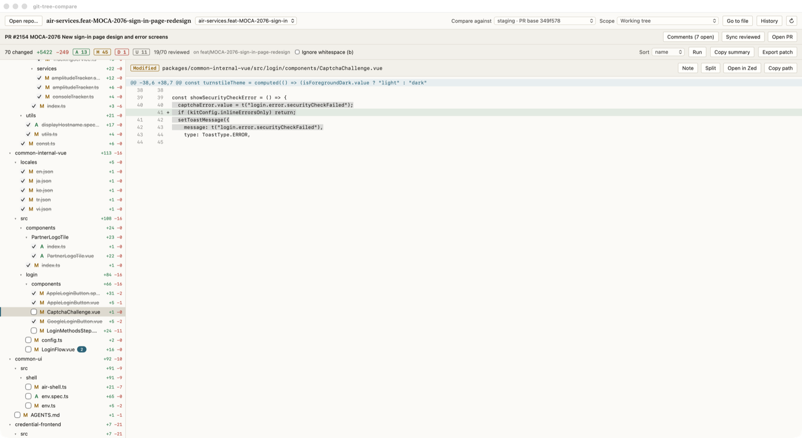

# git-tree-compare

A desktop app that shows what a branch changes, file by file, against the branch it merges into.
It is the preview of your pull request, without leaving your machine.

Created by **Tin Nguyen**.



## Features

- Compare your working tree or any commit against a branch, tag, or remote branch
- Changed files as a folder tree, with status, line counts, and filtering
- Split or unified diff, optional whitespace ignore, and hunk navigation
- Mark files as reviewed, one at a time or in batches, and keep notes per file
- Pull requests: see the PR's base, open review comments inline in the diff, and sync your reviewed files to the PR on GitHub
- Warns when a file would conflict with the base
- Compare with a git worktree, and browse past comparisons in History
- Run a command (such as tests) against the changed files
- Embedded terminal in the repository, toggled with `` Ctrl+` ``
- Export a Markdown summary or a `.patch` file

## Install

1. Download the latest zip from the [Releases](https://github.com/tinwritescode/git-tree-compare/releases) page.
2. Unzip it and move `git-tree-compare.app` to `/Applications`.
3. Open it. If macOS blocks it the first time, right-click the app and choose **Open**.

The app checks for a newer release when it starts. When one exists, the banner offers **Install and restart**, which replaces the app and reopens it. Releases without a checksum file only offer **Download**.

### Requirements

- macOS and `git` on your `PATH`
- [GitHub CLI](https://cli.github.com/) (`gh`), logged in, for pull request features and update checks
- [Zed](https://zed.dev/) if you want **Open in Zed** (optional)

## Usage

### Open a repository

- Open the app and choose **Open repository…**. Browse folders, or pick a recent one.
- Or from a terminal, pass the path:

```bash
git-tree-compare /path/to/repo
git-tree-compare /path/to/repo --base origin/main
```

A second launch with a path hands the repository to the running window.

### Compare

1. Pick the branch to compare against in **Compare against**. The default is the pull request's base when there is one.
2. Pick **Working tree** in **Scope** to see your uncommitted changes too, or a commit to see that commit alone.
3. Click a file in the tree to see its diff.

If the base is not in your clone, the app says so and suggests `git fetch`.

### Review files

- Tick the box next to a file, or press `x`, to mark it reviewed.
- Select several files with `⌘`-click or `⇧`-click, then press `x` to mark them all.
- Click **Sync reviewed** on a pull request to mark those files as viewed on GitHub.

### Right-click a file

- **Open in Zed** opens the file in Zed.
- **Copy path** copies the path, or all selected paths.
- **Mark reviewed** marks the file, or the whole selection, as reviewed.
- **Revert to base** restores the selected changed files to the base version. It discards your local edits to them, so click it twice to confirm. Added, untracked, and renamed files are skipped, since they have no base version to restore.

### Pull request comments

When the current branch has an open pull request, the bar above the diff shows **Comments (N open)**.

- Click it to list review threads and conversation comments, grouped by file.
- Open a file from the list to jump to its diff. Review threads appear under the line they were left on.
- Each file in the tree shows the number of open threads on it.

Comments are read-only. Reply and resolve on GitHub.

## Keyboard shortcuts

Press `?` in the app to see this list.

| Keys | Action |
| --- | --- |
| `↑` `↓` | Previous or next file |
| `/` | Filter files |
| `⌘P` | Quick open |
| `o` | Open the file in Zed |
| `⌘`-click | Add or remove a file from the selection |
| `⇧`-click | Select a range of files |
| `x` | Mark the selection reviewed (or unmark) |
| `Esc` | Clear the selection |
| `[` `]` | Previous or next hunk |
| `v` | Split or unified view |
| `b` | Ignore whitespace |
| `n` | Note for the file |
| `t` | Run a command |
| `r` | Refresh |
| `` Ctrl+` `` | Show or hide the terminal |
| `?` | Show or hide the shortcut list |

## Build from source

Requires Go, Node.js, and the [Wails v2](https://wails.io) CLI.

```bash
cd frontend && npm install && cd ..
wails build
```

The app is written to `build/bin/git-tree-compare.app`. Run the tests with `go test ./...`.

### Publish a release

Bump `appVersion` in `updates.go` and `productVersion` in `wails.json` to the same version, then build:

```bash
wails build
cd build/bin
ditto -c -k --keepParent git-tree-compare.app git-tree-compare-macos.zip
shasum -a 256 git-tree-compare-macos.zip > git-tree-compare-macos.zip.sha256
```

Create a GitHub release with a `v<version>` tag and attach both files. The `.sha256` file is what lets installed copies update in place, so leave it out only if you want the release to be download-only.

## Author

Tin Nguyen
