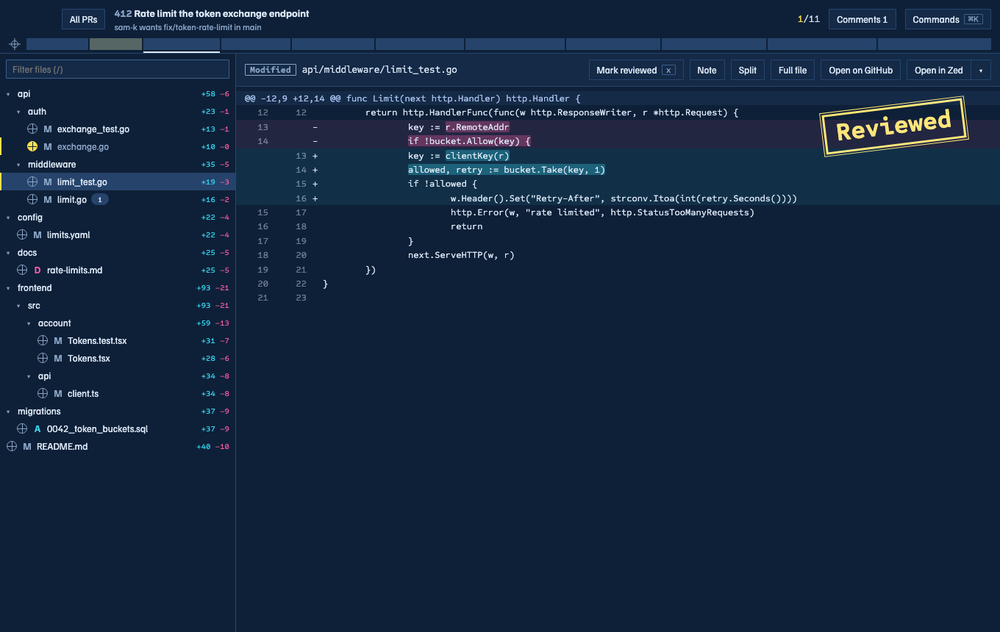

# git-tree-compare

A desktop app for reviewing open pull requests, file by file, from the keyboard.
Marking a file reviewed here marks it viewed on GitHub.

Created by **Tin Nguyen**.



## Features

- Every open pull request in a repository, with the ones waiting for your review first
- Open a pull request without checking it out: your branch and uncommitted work stay as they are
- Review a single commit, or a branch against its base, without a pull request
- Changed files as a folder tree, with status, line counts, and filtering
- Split or unified diff, optional whitespace ignore, and hunk navigation
- Press `x` to mark a file reviewed, here and on GitHub, then move to the next unreviewed file
- Viewed state comes from GitHub, and files changed since you viewed them are flagged
- Review threads inline in the diff, and notes per file
- Run a command (such as tests) against the changed files
- Embedded terminal in the repository, toggled with `` Ctrl+` ``
- Export a Markdown summary or a `.patch` file

## Install

1. Download the latest zip from the [Releases](https://github.com/tinwritescode/git-tree-compare/releases) page.
2. Unzip it and move `git-tree-compare.app` to `/Applications`.
3. Open it. If macOS blocks it the first time, right-click the app and choose **Open**.

The app checks for a newer release when it starts. When one exists, the banner offers **Install and restart**, which replaces the app and reopens it. Releases without a checksum file only offer **Download**.

### Requirements

- macOS and `git` on your `PATH`
- [GitHub CLI](https://cli.github.com/) (`gh`), logged in
- A local clone of the repository you review
- An editor such as [Zed](https://zed.dev/) if you want to open files from the app (optional)

## Usage

### Open a repository

- Open the app and choose **Open repository…**. Browse folders, or pick a recent one.
- Or from a terminal, pass the path:

```bash
git-tree-compare /path/to/repo
```

A second launch with a path hands the repository to the running window.

To install the `git-tree-compare` command, press `⌘K` in the app and choose **Install 'git-tree-compare' command in PATH**. The app writes it to the first of `~/.local/bin`, `/usr/local/bin` or `/opt/homebrew/bin` that your shell's `PATH` lists, and keeps it up to date after each app update.

### Pick a pull request

The app lists every open pull request and refreshes the list every minute. If your checked-out branch has an open pull request, it opens directly. Press `p` to go back to the list.

### Review a commit or a branch

Press `⌘K` and choose **Review a commit…** or **Review a branch…**. Pick from the list, or type any ref git understands, such as `HEAD~2`. For a branch, then pick the base it goes into; the default branch is listed first.

From a terminal:

```bash
git-tree-compare . --commit a1b2c3d
git-tree-compare . --branch feat/x
git-tree-compare . --branch feat/x --base staging
```

- A commit shows what it changed against its first parent.
- A branch shows what it adds since it left the base, as a pull request would. The base defaults to `main` or `master`, read from `origin` when it has that branch.
- Marks stay on this machine. Comments and GitHub sync apply to pull requests only.

### Review files

- Press `x`, or tick the box next to a file, to mark it reviewed. The app moves to the next unreviewed file.
- Select several files with `⌘`-click or `⇧`-click, then press `x` to mark them all.
- Press `x` on a reviewed file to unmark it, here and on GitHub.
- If GitHub cannot be reached, the mark stays on screen and the app keeps trying.
- A file tagged **changed** was changed by a push after you reviewed it.

### Right-click a file

- **Open in editor** opens your local copy of the file, which may differ from the pull request if another branch is checked out.
- **Copy path** copies the path, or all selected paths.
- **Mark reviewed** marks the file, or the whole selection, as reviewed.

### Comments

Press `c` to list review threads and conversation comments, grouped by file.

- Open a file from the list to jump to its diff. Review threads appear under the line they were left on.
- Each file in the tree shows the number of open threads on it.

Comments are read-only. Reply and resolve on GitHub.

## Keyboard shortcuts

Press `?` in the app to see this list.

| Keys | Action |
| --- | --- |
| `↑` `↓` | Previous or next file, or pull request in the list |
| `Enter` | Open the pull request |
| `p` | Back to all pull requests |
| `/` | Filter |
| `⌘K` | All commands |
| `⌘P` | Go to file |
| `⇧⌘F` | Search the changed files at the pull request's head |
| `x` | Mark reviewed here and on GitHub (or unmark) |
| `⌘`-click | Add or remove a file from the selection |
| `⇧`-click | Select a range of files |
| `Esc` | Clear the selection |
| `[` `]` | Previous or next hunk |
| `v` | Split or unified view |
| `b` | Ignore whitespace |
| `n` | Note for the file |
| `c` | Comments |
| `o` | Open the file in your editor |
| `t` | Run a command |
| `r` | Refresh |
| `` Ctrl+` `` | Show or hide the terminal |
| `?` | Show or hide the shortcut list |

## Build from source

Requires Go, Node.js, and the [Wails v2](https://wails.io) CLI.

```bash
cd frontend && npm install && cd ..
wails build
```

The app is written to `build/bin/git-tree-compare.app`. Run the tests with `go test ./...` and, in `frontend`, `npm test`.

### Publish a release

Bump `appVersion` in `updates.go` and `productVersion` in `wails.json` to the same version, then build:

```bash
wails build
cd build/bin
ditto -c -k --keepParent git-tree-compare.app git-tree-compare-macos.zip
shasum -a 256 git-tree-compare-macos.zip > git-tree-compare-macos.zip.sha256
```

Create a GitHub release with a `v<version>` tag and attach both files. The `.sha256` file is what lets installed copies update in place, so leave it out only if you want the release to be download-only.

## Author

Tin Nguyen
